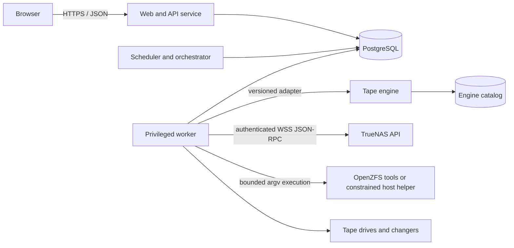

# TapeScale architecture

Status: engineering preview
Specification baseline: TrueNAS LTO Backup System requirements v1.1, 11 November 2026

TapeScale is a control plane for protecting TrueNAS data on LTO media. It deliberately does not invent a tape-record format. Product policy and operator workflows belong to TapeScale; physical records, volume spanning, tape positioning, and the engine catalog belong to a qualified tape engine.

No general physical tape, changer, ACL, or disaster-recovery qualification is implied by this repository. A passed G0.2 run is evidence only for its exact recorded tuple. See [QUALIFICATION.md](QUALIFICATION.md).

## Runtime boundaries



The architecture separates three custom Rust runtime responsibilities. The engineering-preview Compose deployment has `api`, `scheduler`, `worker`, and `postgres` services. PostgreSQL is the handoff boundary; no service relies on an in-memory queue for durable work:

- The web/API service authenticates users, enforces request-level authorization, creates audited intents, and serves the compiled browser application. It has no tape devices, writable host path, or Docker socket. The G0.2 test stack gives it read-only source/restore views and only `DAC_READ_SEARCH` for path containment and mount-mode preflight; a future qualified design moves filesystem proof to the fenced worker.
- The scheduler evaluates timezone-aware schedules, downtime/catch-up policy, retention graphs, recovery dependencies, resource availability, and movement plans. It creates durable work in PostgreSQL and has no tape devices or source/restore mounts.
- The worker performs privileged orchestration and is the only component allowed to touch approved source mounts, restore destinations, tape/changer devices, ZFS integration, or the engine control interface. Worker authorization is checked again at execution time.
- The recovery CLI is a separate Rust binary intended to inspect recovery bundles, identify media, rebuild/import catalog information through supported interfaces, and initiate recovery without the original TapeScale database.

The current binaries are `tapescale-api` on port 8080, `tapescale-scheduler`, `tapescale-worker`, and `tapescale-recovery`. PostgreSQL 16 is the durable product store and coordination boundary. The attended operational backup path now uses the same pinned physical Bacula adapter as G0.2, while production qualification remains gated. Explicit lab flags enable durable rewind/unload, the Bacula Community 15.0.3 `btape test`, one-volume full-file backup/write-readback, a separate G0.2 restore-comparison exercise, and later attended read-only rehearsals. An operational backup creates a recovery point only after an exact physical Data readback and immutable-source recheck; it does not claim `restore_test`. G0.2 creates its recovery point only after physical readback plus an independently compared isolated restore.

Browser JavaScript or TypeScript and build tooling are permitted. Runtime API, scheduling, policy, workers, adapters, helpers, and recovery logic must remain Rust. PostgreSQL, OpenZFS, the selected tape engine, and qualified tape utilities are existing Linux components rather than custom TapeScale backend code.

## Authority and catalog ownership

TapeScale is authoritative for:

- users, roles, sessions, MFA, and reauthentication;
- TrueNAS connections, source selections, and logical source identity;
- policies, schedules, retention, holds, and encryption lineage;
- user-visible jobs, attempts, state transitions, and notifications;
- restore plans, approved destinations, and destructive-action previews;
- locations, planned movements, confirmed custody, and correction history;
- cross-system stable identifiers and reconciliation state.

The selected engine is authoritative for:

- its physical backup records and on-tape format;
- record checksums, volume spanning, spooling, and proven restart boundaries;
- tape position and end-of-media handling;
- its catalog records exposed through supported interfaces.

TapeScale never edits undocumented engine tables. Stable identifiers join records across catalogs. If physical observation, TapeScale state, and engine state disagree, the media is blocked and a reconciliation workflow is created.

## Domain model

The durable model is grouped by responsibility:

- Identity: users, roles, sessions, MFA factors, recovery codes, and reauthentication challenges.
- Sources: TrueNAS systems, datasets and zvols, source selections, exclusions, snapshots, snapshot holds, consistency hooks, and configuration exports.
- Policy: protection policies, schedules, retention rules, verification rules, archives, key lineages, and approved restore destinations.
- Orchestration: job definitions, runs, attempts, transitions, leases, resource requests, media requests, and cancellation intents.
- Recovery: recovery points, backup records, dependency edges, volume records, manifests, file metadata and digests, native streams, verification runs, restore plans, and restore results.
- Hardware: drives, changers, slots, stable device identities, capability observations, reconciliation state, and durable non-data motion requests.
- Media: cartridges, formats, pools, reservations, locations, custody events, holds, and reuse evaluations.
- Operations: rotation plans, movement tasks, confirmations, notifications, audit events, catalog exports, recovery bundles, and component-version evidence.

All operational records use stable identifiers and record actor, time, correlation ID, and structured evidence. Corrections append evidence; they do not erase prior custody or audit history.

## Job lifecycle

The externally visible states are intentionally truthful:

```text
requested -> waiting-for-media -> queued -> preparing -> writing -> written -> verifying -> verified
                               \-> blocked/interrupted
                               \-> failed/canceled
```

- `written` means every required record and finalization operation succeeded. It does not mean verified.
- `verified` means the recorded verification scope completed through the recovery decoding path from the actual media. It does not mean a restore drill passed.
- A failed or incomplete run cannot become an incremental base.
- A reset, disconnect, or uncertain tape position blocks continuation pending reconciliation.
- Cancellation preserves prior valid recovery points and cleans up only TapeScale-owned snapshots and holds when dependency rules permit.

The scheduler persists due occurrences and dispatchable work in PostgreSQL; the worker claims durable execution and device leases there. A drive has one controller at a time; changer actions are serialized. Lease expiry after a crash is not permission to resume writing: the new worker first reconciles physical position and engine state.

Lab drive motion follows the same separation: the API records an exact stable-identity-bound `rewind` or `unload` intent with a designated-scratch-media acknowledgement, and only the singleton worker can claim the drive lease and invoke an allowlisted `mt-st` argument vector. The worker rechecks current identity, path, firmware, access, kernel immediate-mode/outstanding-I/O state, loaded media, and TapeScale's prior-motion certainty before execution and records bounded output plus before/after evidence. Linux treats rewind/offline as recovery operations when the kernel lost its internal tape position; success still requires an affirmative BOT or no-media postcondition. No arbitrary command string crosses the API boundary. Other direct motion, explicit filemark, seek, spacing, retension, label, format, erase, or general data commands remain unavailable. Linux may nevertheless finalize another controller's prior write with a filemark before rewind/offline, which is why this unqualified path is scratch-only.

The G0.1 qualification path is a separate destructive intent. The operator selects a registered unprotected non-WORM cartridge, types its exact label into a closed confirmation phrase, and acknowledges both scratch designation and complete overwrite. PostgreSQL reserves that cartridge and fences the exact reconciled drive. The singleton worker re-probes the bound path and identity, writes a generated per-run Bacula Storage Daemon configuration, and starts only `/usr/sbin/btape -c <config> /dev/nstN` with the fixed `test\n` standard-input transcript. It does not start `bacula-sd` or accept a user-supplied command. On `btape` success the worker performs the separately allowlisted rewind and accepts the run only after the same identity is observed ready at BOT. Failure, timeout, cancellation, lease loss, or an unverifiable postcondition leaves the run failed/interrupted and revokes drive reconciliation. Events and bounded tool evidence are append-only. Even a pass leaves G0 open and creates no recovery point, verified backup, engine selection, or on-tape-format claim.

The operational backup boundary adds durable plans and requests ahead of the same fenced data executor. A plan binds an operator-attested immutable relative path under read-only `/source`, optional scratch pool, retention, timezone, and the only supported schedule: Saturday 02:00 Full. Manual and scheduled starts first commit a `job_run`, `backup_request`, correlation identity, and append-only events in `waiting_for_media`. Scheduler catch-up is idempotent and coalesces missed weeks, but carries no drive, cartridge, or overwrite authority. An operator must select one exact trusted drive and eligible scratch cartridge and type `OVERWRITE <label> FOR BACKUP <request UUID>`. Assignment atomically revalidates compatibility, current qualification, identity, content/holds/WORM/custody/reservation state, optional pool membership, and drive readiness before binding the original job identity to a physical run.

The worker inventories the immutable source, commits the destructive media boundary, prepares and labels the exact volume, executes one Bacula Full job, and submits a correlated `Level=Data` verification that rereads the physical media. It then rescans the source to detect mutation. Atomic success requires the source manifest, finalized engine write, complete physical readback, and unchanged input; it creates the recovery point, volume record, `write_complete`, and `full_readback` verification records together. No restore or manifest comparison occurs on this path, so it cannot emit a restore-test claim. Waiting cancellation is immediate; claimed cancellation is durable and cooperative at safe worker/Bacula boundaries. Failed or uncertain writes never create a recovery point.

The G0.2 data path is another explicit, destructive, laboratory-only intent. A profile binds a normalized relative selection beneath the read-only `/source` mount to an isolated relative destination beneath `/restore`. Queueing requires the exact passed G0.1 drive/cartridge combination, all destructive/scratch acknowledgements, an explicit encryption-disabled deviation, and `WRITE <profile name> TO <cartridge label> AND RESTORE VERIFY`. PostgreSQL atomically binds the source snapshot, drive identity, cartridge, pinned engine/adapter/format versions, reservations, and fenced leases. Catalog proof uses Bacula's persisted one-byte job codes, including `V/A` for a `Level=Data` verify (`D` is the unrelated differential-backup level).

The worker independently inventories and hashes the source, persists append-only evidence, and commits a durable media-write boundary. Qualification, an interrupted prior attempt, or another scratch workflow can leave records or a valid label at BOT, so the worker uses one fixed internal BOT file-mark command to invalidate prior scratch contents and rewinds again; that destructive primitive is unavailable to the public motion API. It renders fixed Bacula 15.0.3 resources and starts process-isolated Director, Storage Daemon, and File Daemon instances under the singleton controller. A restricted fixed-input `bconsole` adapter labels only the selected scratch volume, submits one full file job, correlates the exact engine JobId, requires strict terminal success, submits `Level=Data` verification against that job, then performs a normal Bacula restore into the server-generated isolated run directory. TapeScale inventories the restored tree independently and compares paths, SHA-256 content, and declared metadata coverage. Only an exact match plus valid engine/tape evidence is atomically promoted to a verified recovery point and volume record. Warnings, verify differences, missing evidence, source changes, lease loss, cancellation, or cleanup uncertainty cannot pass.

The attended restore-rehearsal path is a separate read-only intent derived from an unexpired, blocker-free restore plan. It accepts only a passed G0.2 `file/full` origin with one finalized volume, no dependencies or key lineage, the pinned adapter/format, an intact source-manifest artifact, and one selected current exact G0.1-qualified drive/cartridge tuple. Queueing binds the plan and preview hash, original Bacula backup JobId/pool/volume, retained manifest identity, destination, drive identity, cartridge, versions, reservation, correlation ID, and later fencing tokens. The singleton worker re-probes the exact SAS identity, validates the backup catalog/volume before dispatch, and recreates the pinned runtime for the original pool. Its Bacula path can issue only the fixed normal restore and cancel/read-status commands; after any possible tape read, the worker also issues the allowlisted cleanup rewind and requires ready-at-BOT. It has no rehearsal path to label, erase, invalidate BOT, back up, verify-write, or otherwise mutate tape.

Every rehearsal destination is server generated beneath the planned new relative directory and rehearsal UUID. The worker verifies the retained manifest's path, length, artifact SHA-256, format, counts, coverage, and entry digest; restores the entire original job; validates the new restore JobId's catalog relationship; inventories the output independently; and requires an exact comparison. Drive/media leases, heartbeats, phase events, engine correlation, cancellation intent, immutable artifacts, result, and cleanup evidence are durable. Atomic success appends a `restore_test` verification to the existing point and never creates or upgrades a recovery point. Container CI exercises the same catalog contract with an LTO-typed File device, stops all three Bacula daemons, makes the source unavailable, starts a fresh runtime, and byte-compares a second restore. This deterministic gate validates software integration but does not replace physical SAS/LTO qualification.

These paths are not the general engine contract: they intentionally exclude encryption, spanning, incrementals, changers, native ZFS, schedules other than the fixed weekly full, catalog-loss reconstruction, partial selection, destination merge/replace, automatic publication, and broad metadata qualification. Bacula remains authoritative for its physical job/volume/catalog records; TapeScale retains the cross-catalog binding, manifests, comparison, and operator evidence.

## Backup representations

File mode captures a defined immutable snapshot tree, exact selection rules, namespace state, metadata, and SHA-256 content digests while reading the selected snapshot. Exact incrementals must account for additions, changes, moves, deletions, and metadata-only changes.

Native mode stores versioned full/incremental `zfs send` streams plus dataset, snapshot, property, feature, key, and dependency records. Zvols are block volumes and are not advertised as browsable file trees. Interrupted native streams restart from the beginning unless a narrower engine recovery unit is demonstrated and recorded.

Both mode creates two explicit representations. It is not an implicit claim that a file index makes a native stream seekable by filename.

## Logical source identity

Each run records immutable snapshot name, GUID or stable identifier, capture time, selected descendants, and resolved exclusions. Changing physical snapshot mount paths map to a stable logical root used for catalog identity and restore browsing. Separate pools are described as separate crash-consistency boundaries unless a validated integration establishes something stronger.

TapeScale releases only its own holds, and only after every backup, retry, verification, and dependency that requires the snapshot has ended. User-created snapshots are never removed as job cleanup.

## Engine adapter contract

The adapter is versioned separately from the product API and exposes structured operations for:

- dependency and version health;
- device discovery, stable identity, inventory, and capabilities;
- media identity, reservation, label, import, and reconciliation;
- file/native write planning and execution;
- operation polling, safe cancellation, and durable recovery units;
- read-back verification, restore planning, and restore execution;
- catalog export, import, and reconstruction.

Arguments are passed directly to processes without a shell. Input is validated, output is bounded, timeouts and cancellation are explicit, and both producer and consumer exit status are required for success. The adapter must never infer structured state from decorative console output when a supported structured interface exists.

The development simulator remains available for broader policy and failure testing. It is not tape-engine qualification and must be visibly distinguished from the fenced Bacula adapter used by the operational full-backup and G0.2 paths in system status and diagnostic exports.

## Retention and overwrite gate

Retention is evaluated over the recovery-point dependency graph. A base, intermediate increment, manifest, tape, or key remains protected until its final retained dependent expires. Entire cartridges remain protected while any contained record is retained, held, archived indefinitely, incomplete-but-recoverable, or reserved.

An overwrite decision is a conjunction, never a best effort:

1. Physical media identity is known and matches the requested cartridge.
2. Engine and TapeScale catalogs agree, or reconciliation has explicitly resolved the difference.
3. No retained recovery point, dependency, hold, archive, export, active job, or pending custody task protects the tape.
4. The actual format/generation is writable by the selected drive.
5. Health and position are known.
6. Policy permits reuse.
7. The actor has authority; exceptional destruction also has current reauthentication and an unchanged affected-object preview.

Failure or uncertainty at any step denies the write.

The preview implements the decision side of this boundary as a Media Control Center. Inventory summaries and cartridge dossiers are derived from the durable catalog, recovery graph, volume records, verification, custody, holds, reservations, and drive observations. Pool assignment and operator-created hold mutations require an expected cartridge `state_version`; a database trigger advances that version for every cartridge update, including worker and custody updates outside the media service. Idempotency receipts, cartridge state, append-only audit, and notification outbox records commit transactionally.

Reuse evaluation accepts an explicit selected drive and returns the conjunction above, including actionable blockers and affected recovery points. It is deliberately read-only. The preview provides no general erase, relabel, recycle, reuse execution, or policy-override primitive, so an allowed evaluation cannot itself alter media or dispatch engine work.

## API shape

The JSON API is versioned below `/api/v1`. Principal groups are authentication, setup/preflight, TrueNAS and sources, policies and schedules, jobs and runs, devices and media, recovery points and verification, restore planning/execution, locations and rotations, keys and recovery bundles, notifications, audit, and diagnostics.

The production contract makes destructive operations three-step workflows: generate a preview, reauthenticate, then execute using a short-lived token bound to the preview hash and exact object versions. The explicitly unauthenticated G0.1, operational-backup, and G0.2 paths are temporary, isolated-lab exceptions with separate scratch-media acknowledgements and exact typed phrases; their constraints are documented in [Security](SECURITY.md). They must not be exposed as production workflows.

## Deployment rules

- Pin release images and the Rust toolchain; commit the lockfile.
- Persist PostgreSQL, engine catalog/configuration, TapeScale state, manifests, recovery exports, and required spool/staging data outside containers.
- Keep database and engine control ports on private networks.
- Mount sources read-only and restore targets writable only into the worker. If the API performs G0.2 path preflight, give it read-only views only.
- Map only named tape/changer devices. Never mount host root or the Docker socket.
- Use mounted secret files or the platform secret facility; do not place long-lived credentials in checked-in environment files.
- Expose dependency-specific readiness for database, engine, TrueNAS API/certificate, snapshot access, native-ZFS path, devices, keys, scratch capacity, and compatible media.

See [TRUENAS-DEPLOYMENT.md](TRUENAS-DEPLOYMENT.md) for the deployment contract.

## Version and compatibility policy

Every release records the TapeScale version, schema version, engine and adapter version, on-tape format, manifest format, recovery-bundle version, Rust toolchain, TrueNAS/OpenZFS version, host drivers, and device firmware used for qualification. Format changes require regression restoration from supported earlier releases or a maintained compatible reader.

Generation compatibility rules are data, separate from physical qualification evidence. Detection and successful simulation never become a hardware qualification result.

## Preview implementation versus target contract

Normative language in this document describes the release contract, not a claim that every path is complete. The preview implements Rust API/scheduler/worker/recovery process boundaries, PostgreSQL schema and coordination primitives, SAS identity/status discovery, lab-only rewind/unload, the fenced Bacula `btape` harness, durable attended operational full backups with weekly request scheduling and physical readback, the G0.2 single-volume file write/readback/restore path, a durable attended rehearsal of those exact verified points, simulator-backed broader workflows, LTO capability rules, dependency-aware retention, the read-only media reuse gate, versioned pool/hold operations, core state machines, safe process execution, and the guided browser workflow. Production authentication/MFA, TrueNAS snapshot automation and native streaming, destructive reuse execution, a generally qualified engine/format, spanning/incrementals, encryption/key lifecycle, changer control, notifications, general restore execution, and clean-host media reconstruction remain incomplete or unqualified. The acceptance ledger is authoritative for evidence status.
