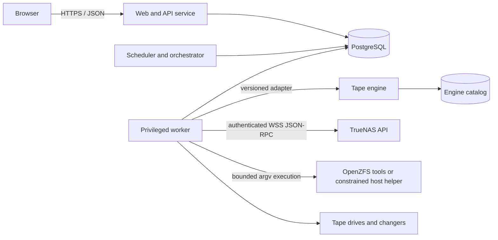

# TapeScale architecture

Status: engineering preview
Specification baseline: TrueNAS LTO Backup System requirements v1.1, 11 November 2026

TapeScale is a control plane for protecting TrueNAS data on LTO media. It deliberately does not invent a tape-record format. Product policy and operator workflows belong to TapeScale; physical records, volume spanning, tape positioning, and the engine catalog belong to a qualified tape engine.

No physical tape, changer, ACL, or disaster-recovery qualification is implied by this repository. See [QUALIFICATION.md](QUALIFICATION.md).

## Runtime boundaries



The architecture separates three custom Rust runtime responsibilities. The engineering-preview Compose deployment has `api`, `scheduler`, `worker`, and `postgres` services. PostgreSQL is the handoff boundary; no service relies on an in-memory queue for durable work:

- The web/API service authenticates users, enforces request-level authorization, creates audited intents, and serves the compiled browser application. It has no tape devices, host root, or Docker socket.
- The scheduler evaluates timezone-aware schedules, downtime/catch-up policy, retention graphs, recovery dependencies, resource availability, and movement plans. It creates durable work in PostgreSQL and has no tape devices or source/restore mounts.
- The worker performs privileged orchestration and is the only component allowed to touch approved source mounts, restore destinations, tape/changer devices, ZFS integration, or the engine control interface. Worker authorization is checked again at execution time.
- The recovery CLI is a separate Rust binary intended to inspect recovery bundles, identify media, rebuild/import catalog information through supported interfaces, and initiate recovery without the original TapeScale database.

The current binaries are `tapescale-api` on port 8080, `tapescale-scheduler`, `tapescale-worker`, and `tapescale-recovery`. PostgreSQL 16 is the durable product store and coordination boundary. The only available engine adapter is the simulator; production tape operations remain gated. An explicit lab flag can enable durable rewind and unload requests, but those motions never create recovery data or physical-qualification evidence.

Browser JavaScript or TypeScript and build tooling are permitted. Runtime API, scheduling, policy, workers, adapters, helpers, and recovery logic must remain Rust. PostgreSQL, OpenZFS, the selected tape engine, and qualified tape utilities are existing Linux components rather than custom TapeScale backend code.

## Authority and catalog ownership

TapeScale is authoritative for:

- users, roles, sessions, MFA, and reauthentication;
- TrueNAS connections, source selections, and logical source identity;
- policies, schedules, retention, holds, and encryption lineage;
- user-visible jobs, attempts, state transitions, and notifications;
- restore plans, approved destinations, and destructive-action previews;
- locations, planned movements, confirmed custody, and correction history;
- cross-system stable identifiers and reconciliation state.

The selected engine is authoritative for:

- its physical backup records and on-tape format;
- record checksums, volume spanning, spooling, and proven restart boundaries;
- tape position and end-of-media handling;
- its catalog records exposed through supported interfaces.

TapeScale never edits undocumented engine tables. Stable identifiers join records across catalogs. If physical observation, TapeScale state, and engine state disagree, the media is blocked and a reconciliation workflow is created.

## Domain model

The durable model is grouped by responsibility:

- Identity: users, roles, sessions, MFA factors, recovery codes, and reauthentication challenges.
- Sources: TrueNAS systems, datasets and zvols, source selections, exclusions, snapshots, snapshot holds, consistency hooks, and configuration exports.
- Policy: protection policies, schedules, retention rules, verification rules, archives, key lineages, and approved restore destinations.
- Orchestration: job definitions, runs, attempts, transitions, leases, resource requests, media requests, and cancellation intents.
- Recovery: recovery points, backup records, dependency edges, volume records, manifests, file metadata and digests, native streams, verification runs, restore plans, and restore results.
- Hardware: drives, changers, slots, stable device identities, capability observations, reconciliation state, and durable non-data motion requests.
- Media: cartridges, formats, pools, reservations, locations, custody events, holds, and reuse evaluations.
- Operations: rotation plans, movement tasks, confirmations, notifications, audit events, catalog exports, recovery bundles, and component-version evidence.

All operational records use stable identifiers and record actor, time, correlation ID, and structured evidence. Corrections append evidence; they do not erase prior custody or audit history.

## Job lifecycle

The externally visible states are intentionally truthful:

```text
queued -> preparing -> waiting-for-media -> writing -> written -> verifying -> verified
                    \-> blocked/interrupted
                    \-> failed/canceled
```

- `written` means every required record and finalization operation succeeded. It does not mean verified.
- `verified` means the recorded verification scope completed through the recovery decoding path from the actual media. It does not mean a restore drill passed.
- A failed or incomplete run cannot become an incremental base.
- A reset, disconnect, or uncertain tape position blocks continuation pending reconciliation.
- Cancellation preserves prior valid recovery points and cleans up only TapeScale-owned snapshots and holds when dependency rules permit.

The scheduler persists due occurrences and dispatchable work in PostgreSQL; the worker claims durable execution and device leases there. A drive has one controller at a time; changer actions are serialized. Lease expiry after a crash is not permission to resume writing: the new worker first reconciles physical position and engine state.

Lab drive motion follows the same separation: the API records an exact stable-identity-bound `rewind` or `unload` intent with a designated-scratch-media acknowledgement, and only the singleton worker can claim the drive lease and invoke an allowlisted `mt-st` argument vector. The worker rechecks current identity, path, firmware, access, kernel immediate-mode/outstanding-I/O state, loaded media, and position before execution and records bounded output plus before/after evidence. No arbitrary command string crosses the API boundary. Any other motion, tape data read/write, explicit filemark, seek, retension, label, format, or erase command is unavailable. Linux may nevertheless finalize another controller's prior write with a filemark before rewind/offline, which is why this unqualified path is scratch-only.

## Backup representations

File mode captures a defined immutable snapshot tree, exact selection rules, namespace state, metadata, and SHA-256 content digests while reading the selected snapshot. Exact incrementals must account for additions, changes, moves, deletions, and metadata-only changes.

Native mode stores versioned full/incremental `zfs send` streams plus dataset, snapshot, property, feature, key, and dependency records. Zvols are block volumes and are not advertised as browsable file trees. Interrupted native streams restart from the beginning unless a narrower engine recovery unit is demonstrated and recorded.

Both mode creates two explicit representations. It is not an implicit claim that a file index makes a native stream seekable by filename.

## Logical source identity

Each run records immutable snapshot name, GUID or stable identifier, capture time, selected descendants, and resolved exclusions. Changing physical snapshot mount paths map to a stable logical root used for catalog identity and restore browsing. Separate pools are described as separate crash-consistency boundaries unless a validated integration establishes something stronger.

TapeScale releases only its own holds, and only after every backup, retry, verification, and dependency that requires the snapshot has ended. User-created snapshots are never removed as job cleanup.

## Engine adapter contract

The adapter is versioned separately from the product API and exposes structured operations for:

- dependency and version health;
- device discovery, stable identity, inventory, and capabilities;
- media identity, reservation, label, import, and reconciliation;
- file/native write planning and execution;
- operation polling, safe cancellation, and durable recovery units;
- read-back verification, restore planning, and restore execution;
- catalog export, import, and reconstruction.

Arguments are passed directly to processes without a shell. Input is validated, output is bounded, timeouts and cancellation are explicit, and both producer and consumer exit status are required for success. The adapter must never infer structured state from decorative console output when a supported structured interface exists.

The development simulator exists for deterministic policy and failure testing only. It is not tape-engine qualification and must be visibly identified in system status and diagnostic exports.

## Retention and overwrite gate

Retention is evaluated over the recovery-point dependency graph. A base, intermediate increment, manifest, tape, or key remains protected until its final retained dependent expires. Entire cartridges remain protected while any contained record is retained, held, archived indefinitely, incomplete-but-recoverable, or reserved.

An overwrite decision is a conjunction, never a best effort:

1. Physical media identity is known and matches the requested cartridge.
2. Engine and TapeScale catalogs agree, or reconciliation has explicitly resolved the difference.
3. No retained recovery point, dependency, hold, archive, export, active job, or pending custody task protects the tape.
4. The actual format/generation is writable by the selected drive.
5. Health and position are known.
6. Policy permits reuse.
7. The actor has authority; exceptional destruction also has current reauthentication and an unchanged affected-object preview.

Failure or uncertainty at any step denies the write.

## API shape

The JSON API is versioned below `/api/v1`. Principal groups are authentication, setup/preflight, TrueNAS and sources, policies and schedules, jobs and runs, devices and media, recovery points and verification, restore planning/execution, locations and rotations, keys and recovery bundles, notifications, audit, and diagnostics.

Destructive operations are three-step workflows: generate preview, reauthenticate, then execute using a short-lived token bound to the preview hash and exact object versions. A backend call cannot bypass this workflow.

## Deployment rules

- Pin release images and the Rust toolchain; commit the lockfile.
- Persist PostgreSQL, engine catalog/configuration, TapeScale state, manifests, recovery exports, and required spool/staging data outside containers.
- Keep database and engine control ports on private networks.
- Mount sources read-only and restore targets only into the restore worker.
- Map only named tape/changer devices. Never mount host root or the Docker socket.
- Use mounted secret files or the platform secret facility; do not place long-lived credentials in checked-in environment files.
- Expose dependency-specific readiness for database, engine, TrueNAS API/certificate, snapshot access, native-ZFS path, devices, keys, scratch capacity, and compatible media.

See [TRUENAS-DEPLOYMENT.md](TRUENAS-DEPLOYMENT.md) for the deployment contract.

## Version and compatibility policy

Every release records the TapeScale version, schema version, engine and adapter version, on-tape format, manifest format, recovery-bundle version, Rust toolchain, TrueNAS/OpenZFS version, host drivers, and device firmware used for qualification. Format changes require regression restoration from supported earlier releases or a maintained compatible reader.

Generation compatibility rules are data, separate from physical qualification evidence. Detection and successful simulation never become a hardware qualification result.

## Preview implementation versus target contract

Normative language in this document describes the release contract, not a claim that every path is complete. The preview implements Rust API/scheduler/worker/recovery process boundaries, PostgreSQL schema and coordination primitives, SAS identity/status discovery, explicitly enabled lab-only rewind/unload, simulator-backed workflows, LTO capability rules, retention/overwrite policy, core state machines, safe argument-based process execution, and a browser prototype. Production authentication/MFA, TrueNAS control and streaming, a qualified engine, remaining tape motion and all tape data operations, encryption/key lifecycle, actual backup/restore, notification delivery, and clean-host media reconstruction remain incomplete or unqualified. The acceptance ledger is authoritative for evidence status.
